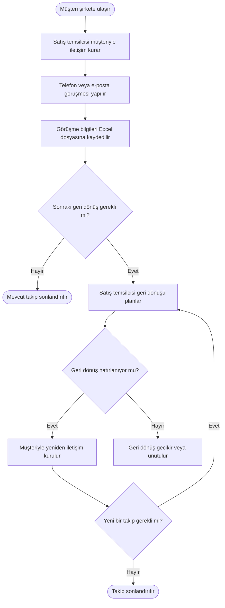

# Mevcut Müşteri Takip Süreci

## 1. Amaç

Bu diyagram, kurgusal şirketin potansiyel müşterilerle iletişim kurma ve görüşme sonrasında takip sürecini mevcut haliyle göstermektedir.

## 2. Mevcut Süreç Akışı

## 3. Diyagram Hakkında

Bu akışta müşteri bilgileri ve görüşme sonuçları Excel dosyalarına kaydedilmektedir. Sonraki geri dönüşün planlanması ve hatırlanması ise standart bir yöntemle yürütülmemektedir.

Bu nedenle geri dönüşün gecikmesi veya unutulması olası sonuçlardan biridir.

## 4. Analiz Notu

Diyagram, satış yöneticisiyle yapılan kurgusal görüşmede edinilen bilgilere göre hazırlanmıştır. Sürecin bazı ayrıntıları henüz doğrulanmadığından diyagram ilk taslak niteliğindedir.

Bir sonraki aşamada mevcut süreçteki sorunları ve iyileştirme fırsatlarını değerlendireceğim.
