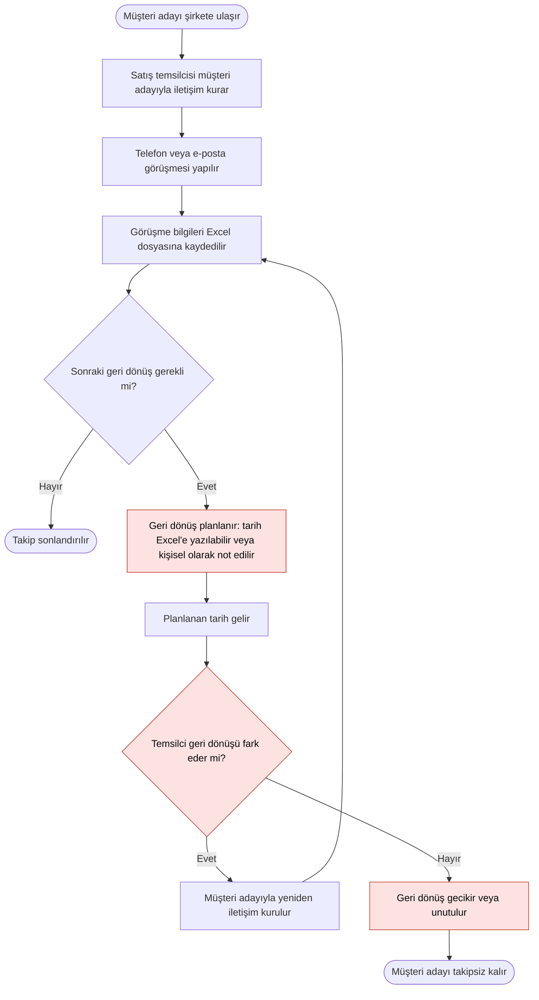

# Mevcut Müşteri Adayı Takip Süreci (AS-IS)

## 1. Amaç

Bu diyagram, kurgusal şirketin müşteri adaylarıyla iletişim kurma ve görüşme sonrası takip sürecini mevcut haliyle (AS-IS) göstermektedir.

## 2. Mevcut Süreç Akışı

Kırmızı ile gösterilen adımlar, sürecin sorunlu noktalarını işaret etmektedir.

## 3. Diyagram Hakkında

Bu akışta müşteri adayı bilgileri ve görüşme sonuçları Excel dosyalarına kaydedilmektedir. Sonraki geri dönüşün planlanması ve hatırlanması ise standart bir yöntemle yürütülmemektedir. Geri dönüş tarihi Excel'e yazılabilmekte ya da kişisel olarak not edilebilmektedir.

Bu nedenle geri dönüşün gecikmesi veya unutulması olası sonuçlardan biridir.

### Tespit Edilen Sorunlar

| ID | Süreç adımı | Sorun | İlgili problem |
| --- | --- | --- | --- |
| P1 | G | Geri dönüş tarihi standart bir yerde tutulmuyor | Geri dönüş tarihlerinin kaydedilmemesi |
| P2 | I, K | Hatırlatma mekanizması yok, fark etmek temsilcinin hafızasına bağlı | Geri dönüşlerin gecikmesi veya unutulması |
| P3 | B | Takibi hangi temsilcinin yürüteceği ortak bir kurala bağlı değil | Sorumlunun belirsizliği |
| P4 | C, D | Önceki görüşmelere ulaşmak için Excel'de arama gerekiyor | İletişim geçmişine ulaşma zorluğu |
| P5 | B, E | Öncelik ortak kurallarla belirlenmiyor | Önceliklendirme eksikliği |
| P6 | D | Tüm bilgi dosyalarda tutuluyor | Dosya kaybı riski |

## 4. Analiz Notu

Diyagram, satış yöneticisiyle yapılan kurgusal görüşmede edinilen bilgilere göre hazırlanmıştır ve ilk taslak niteliğindedir. Aşağıdaki noktalar henüz doğrulanmamıştır:

- Müşteri adayının şirkete hangi kanallardan ulaştığı
- Müşteri adayını hangi temsilcinin devralacağının nasıl belirlendiği
- Geri dönüş tarihinin Excel'de tutulup tutulmadığı
- Satış yöneticisinin mevcut süreçteki rolü

Sürecin sorunları ve hedef durumla farkı için bkz. [Gap Analizi](../docs/02_gap_analysis.md) ve [Önerilen Süreç Akışı](target_process_flow.md).
