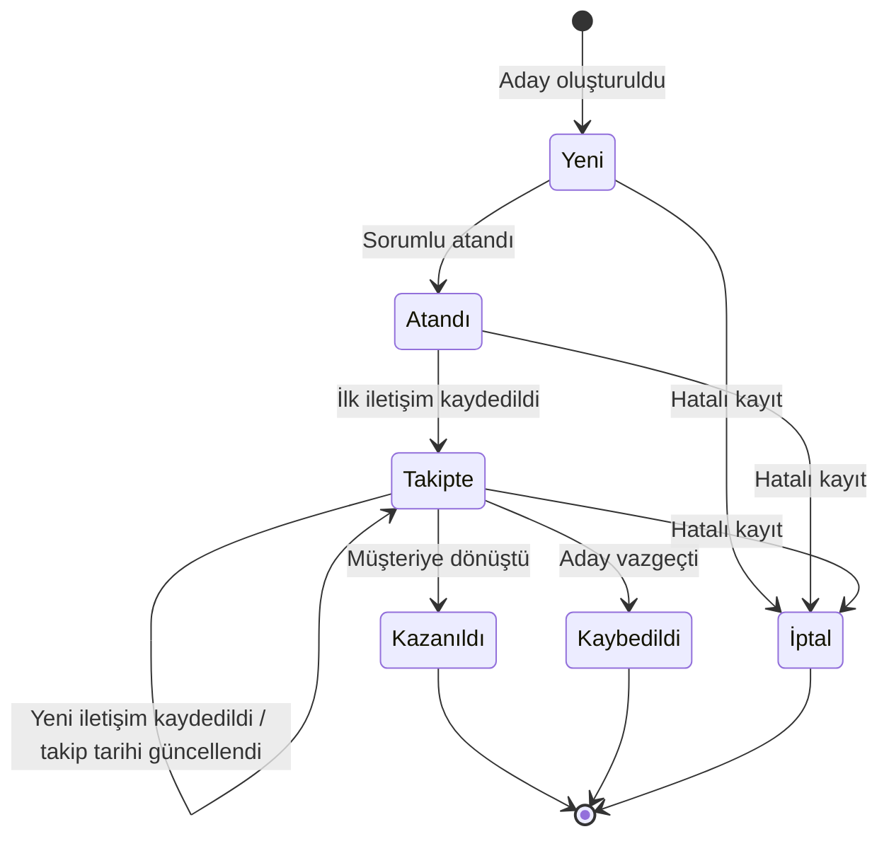

# Müşteri Adayı Durum Diyagramı

## 1. Amaç

Bu doküman, bir müşteri adayı kaydının yaşam döngüsünde hangi durumlarda bulunabileceğini ve bir durumdan diğerine hangi olayla geçtiğini gösterir. Süreç akış diyagramları (`current_process_flow.md`, `target_process_flow.md`) "kim ne yapıyor" sorusunu yanıtlar. Bu doküman "kayıt hangi aşamada" sorusunu yanıtlar.

## 2. Durum Diyagramı

## 3. Durumlar

| Durum | Anlamı | Sorumlu var mı? |
|---|---|---|
| Yeni | Kayıt oluşturuldu, henüz kimseye atanmadı | Hayır |
| Atandı | Bir satış temsilcisi sorumlu oldu, henüz iletişim yok | Evet |
| Takipte | En az bir iletişim kaydı var, takip sürüyor | Evet |
| Kazanıldı | Aday müşteriye dönüştü | Evet |
| Kaybedildi | Aday süreci bıraktı, gerekçe girildi | Evet |
| İptal | Hatalı veya mükerrer kayıt, gerekçe girildi | Değişir |

## 4. Geçiş Kuralları

| Geçiş | Tetikleyen olay | Kural |
|---|---|---|
| Yeni → Atandı | Sorumlu atama | Sorumlu atama yetkisi olan rol yapar |
| Atandı → Takipte | İlk iletişim kaydı | Sorumlu temsilci kendi kaydına girer |
| Takipte → Takipte | Yeni iletişim kaydı | Her iletişimde yeni takip tarihi girilir |
| Takipte → Kazanıldı | Dönüşüm | Sadece sorumlu temsilci veya yönetici yapar |
| Takipte → Kaybedildi | Vazgeçme | Kaybedilme gerekçesi zorunludur |
| Yeni/Atandı/Takipte → İptal | Hatalı kayıt | İptal gerekçesi zorunludur, kayıt silinmez, ayırt edilebilir kalır |

## 5. Diyagramda Durum Olmayan Kavramlar

- **Geciken takip:** Ayrı bir durum değildir. Takip tarihi geçmiş ve kayıt hâlâ "Takipte" ise sistemin gösterdiği bir uyarıdır.
- **Öncelik:** Durumdan bağımsız bir özelliktir. Her durumda değişebilir.

## 6. Açık Sorular

- "Atandı" durumu ayrı bir durum mu olmalı, yoksa "Yeni" ile birleştirilebilir mi?
- Kazanıldı, Kaybedildi veya İptal durumundaki kayıt yeniden açılabilir mi? Kim açabilir?
- Sorumlu değişirse kayıt "Atandı" durumuna geri döner mi, yoksa "Takipte" kalır mı?
- İptal kayıtlar ne kadar süre saklanır?

## 7. İlişkili Dokümanlar

- `docs/10_mvp_scope.md`: F3 sorumlu atama, F4 iletişim geçmişi, F5 takip tarihi, F8 değişiklik geçmişi
- `docs/11_user_roles_and_permissions.md`: hangi rolün hangi geçişi yapabileceği
