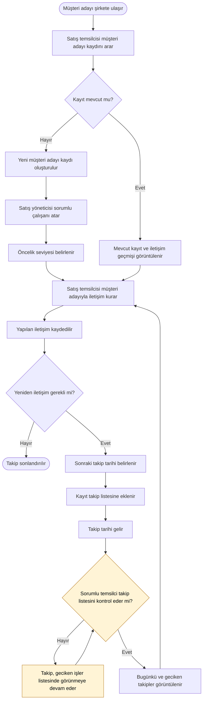

# Önerilen Süreç Akışı (TO-BE)

## 1. Amaç

Bu diyagramda, müşteri adayı takibinin daha düzenli yapılabilmesi için önerdiğim hedef süreci gösteriyorum.

Mevcut süreçte müşteri adayı bilgileri Excel dosyasında tutuluyor ve geri dönüş tarihleri her zaman düzenli kaydedilmiyor. Önerilen süreçte müşteri adaylarının bilgilerinin, iletişim geçmişinin, sorumlu çalışanın ve takip tarihlerinin merkezi bir yapı üzerinden yönetilmesini hedefliyorum.

## 2. Önerilen Süreç

Sarı ile gösterilen adımlar, MVP'de yalnızca kısmen çözülen noktayı işaret eder: otomatik bildirim kapsam dışı olduğu için takibin görülmesi hâlâ temsilcinin listeyi kontrol etmesine bağlıdır.

## 3. Mevcut Süreçteki Sorunların Karşılığı

| Sorun | Hedef süreçteki karşılığı | MVP özelliği | Durum |
| --- | --- | --- | --- |
| P1: Geri dönüş tarihi standart bir yerde tutulmuyor | K, L | F5 | Çözülüyor |
| P2: Hatırlatma mekanizması yok | M, N, O, P | F5 | Kısmen çözülüyor: gecikenler görüntülenir, otomatik bildirim MVP dışıdır |
| P3: Sorumlu belirsiz | F | F3 | Çözülüyor |
| P4: İletişim geçmişine ulaşmak zor | C, E, H | F2, F4 | Çözülüyor |
| P5: Öncelik ortak kurallara bağlı değil | G | F6 | Kısmen çözülüyor: öncelik kriterleri henüz belirlenmedi |
| P6: Dosya kaybı riski | D, H (merkezi kayıt) | - | Yedekleme gereksinimi fonksiyonel olmayan gereksinimlerde ele alınır, diyagramda gösterilmez |

Sorunların ayrıntısı için bkz. [Mevcut Süreç Akışı](current_process_flow.md).

## 4. Beklenen İyileştirmeler

- Müşteri adayı bilgilerinin merkezi bir yerde tutulması.
- İletişim geçmişinin daha kolay takip edilmesi.
- Kaydın takibinden sorumlu çalışanın belli olması.
- Sonraki geri dönüş tarihlerinin kayıt altına alınması.
- Planlanan ve geciken takiplerin görüntülenebilmesi.
- Müşteri adaylarına öncelik seviyesi atanması.
- Takibin kişisel hatırlatmalara olan bağımlılığının azaltılması.

## 5. Analiz Notu

Bu akış, önerilen işleyişi gösteren ilk taslaktır. Aşağıdaki noktalar henüz kesinleştirilmemiştir:

- Mükerrer kayıt kontrolünün hangi bilgilere göre yapılacağı
- Yeni kaydı oluşturan temsilcinin sorumlu atanana kadar kaydı nasıl takip edeceği
- Önceliğin hangi kriterlere göre ve kim tarafından belirleneceği
- Takibin sonlandırılma nedenlerinin (örneğin müşteriye dönüştü, vazgeçti) nasıl kaydedileceği
- Mevcut Excel verilerinin sisteme aktarılıp aktarılmayacağı

Otomatik bildirim ve hatırlatmalar ilk sürümün kapsamı dışındadır, bkz. [MVP Kapsamı](../docs/10_mvp_scope.md). Kullanıcı rolleri ve yetkiler taslak olarak [Kullanıcı Rolleri ve Yetkilendirme](../docs/11_user_roles_and_permissions.md) dosyasında tanımlanmıştır.

Ayrıca bu diyagram, geliştirilmiş bir CRM sisteminin gerçekten mevcut olduğunu veya test edildiğini göstermez. Proje kapsamında önerilen hedef süreci ifade eder.

Bu proje, iş analizi öğrenme amacıyla hazırlanmış kurgusal bir çalışmadır.
