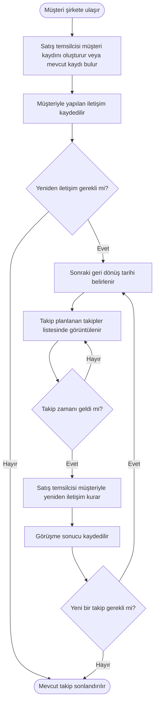

# Önerilen Süreç Akışı (Target Process Flow)

## 1. Amaç

Bu diyagramda, müşteri takibinin daha düzenli yapılabilmesi için önerdiğim hedef süreci gösteriyorum.

Mevcut süreçte müşteri bilgileri Excel dosyasında tutuluyor ve geri dönüş tarihleri her zaman düzenli kaydedilmiyor. Önerilen süreçte müşteri bilgilerinin, iletişim geçmişinin ve takip tarihlerinin merkezi bir yapı üzerinden yönetilmesini hedefliyorum.

## 2. Önerilen Süreç

## 3. Beklenen İyileştirmeler

- Müşteri bilgilerinin merkezi bir yerde tutulması.
- İletişim geçmişinin daha kolay takip edilmesi.
- Sonraki geri dönüş tarihlerinin kayıt altına alınması.
- Planlanan takiplerin görüntülenebilmesi.
- Müşteri takibinin kişisel hatırlatmalara olan bağımlılığının azaltılması.

## 4. Analiz Notu

Bu akış, önerilen işleyişi gösteren ilk taslaktır. Otomatik bildirim, kullanıcı yetkileri ve takip durumlarının nasıl yönetileceği henüz kesinleştirilmemiştir.

Ayrıca bu diyagram, geliştirilmiş bir CRM sisteminin gerçekten mevcut olduğunu veya test edildiğini göstermez. Proje kapsamında önerilen hedef süreci ifade eder.

Bu proje, iş analizi öğrenme amacıyla hazırlanmış kurgusal bir çalışmadır.
