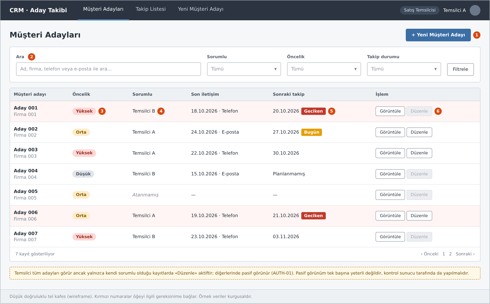
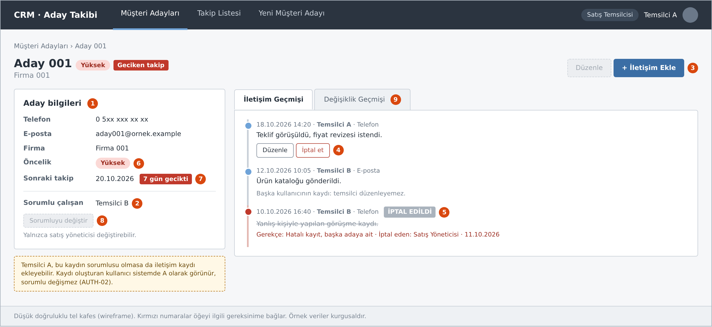
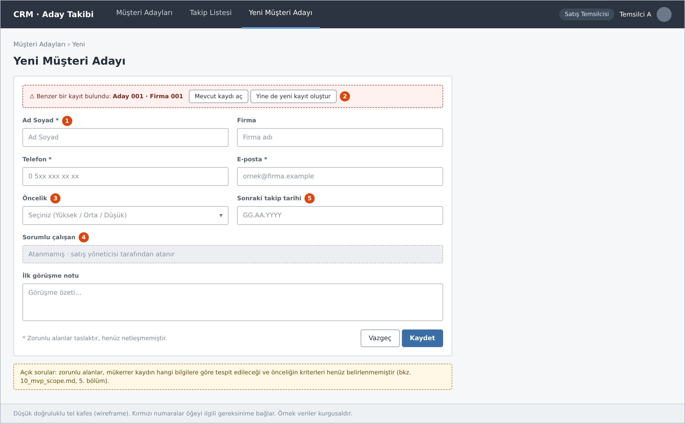
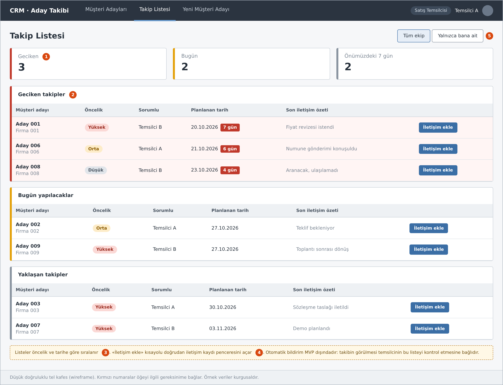
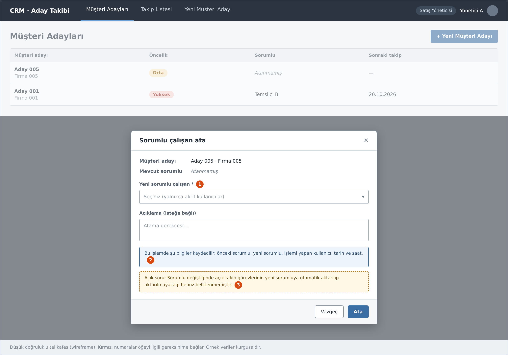

# Ekran Tasarımları (Wireframe)

Bu klasör, MVP kapsamındaki temel ekranların düşük doğruluklu tel kafes tasarımlarını içerir. Ekranlar, giriş yapmış bir **satış temsilcisi** (Temsilci A) gözünden çizilmiştir. Yalnızca sorumlu atama ekranı **satış yöneticisi** (Yönetici A) gözünden gösterilmiştir.

Her ekrandaki kırmızı numaralar, aşağıdaki tablolarda ilgili MVP özelliğine ([10_mvp_scope.md](../docs/10_mvp_scope.md)) ve yetkilendirme kuralına ([11_user_roles_and_permissions.md](../docs/11_user_roles_and_permissions.md)) bağlanmıştır.

**Not:** Bu tasarımlar görsel tasarım değil, gereksinimlerin ekrana nasıl yansıyabileceğini gösteren taslaklardır. Ekranlardaki kişi, firma ve çalışan adları yapay etiketlerdir (Aday 001, Firma 001, Temsilci A, Yönetici A gibi) ve gerçek kişi veya kuruluşlarla ilgisi yoktur. Henüz karara bağlanmamış konular ekranda «taslak» veya «açık soru» notuyla belirtilmiştir.

## Ekran 1: Müşteri Adayı Listesi

| No | Öğe | MVP özelliği | İlgili kural |
| --- | --- | --- | --- |
| 1 | Yeni müşteri adayı butonu | F1 | |
| 2 | Arama ve filtreleme | F2 | |
| 3 | Öncelik sütunu | F6 | |
| 4 | Sorumlu sütunu | F3 | |
| 5 | Sonraki takip tarihi ve «Geciken» rozeti | F5 | |
| 6 | Sorumlu olunmayan kayıtlarda pasif «Düzenle» | F7 | AUTH-01 |

## Ekran 2: Müşteri Adayı Detayı ve İletişim Geçmişi

| No | Öğe | MVP özelliği | İlgili kural |
| --- | --- | --- | --- |
| 1 | Aday bilgileri | F2 | AUTH-01 |
| 2 | Sorumlu çalışan | F3 | |
| 3 | İletişim ekle (sorumlu olmayan kayıtta da aktif) | F4 | AUTH-02 |
| 4 | İletişim geçmişi, yalnızca kendi kaydında düzenle ve iptal | F4 | AUTH-03, AUTH-05 |
| 5 | İptal edilmiş kayıt: ayırt edilebilir, gerekçe ve iptal eden görünür | F4, F8 | AUTH-05 |
| 6 | Öncelik | F6 | |
| 7 | Sonraki takip tarihi ve gecikme bilgisi | F5 | |
| 8 | Sorumluyu değiştir: temsilci için pasif | F3, F7 | AUTH-06 |
| 9 | Değişiklik geçmişi sekmesi | F8 | AUTH-04, AUTH-07 |

## Ekran 3: Yeni Müşteri Adayı

| No | Öğe | MVP özelliği | İlgili kural |
| --- | --- | --- | --- |
| 1 | Aday bilgi alanları | F1 | |
| 2 | Benzer kayıt uyarısı | F1, F2 | Açık soru: mükerrer kayıt |
| 3 | Öncelik seçimi | F6 | Açık soru: öncelik kriterleri |
| 4 | Sorumlu alanı: yöneticiye bırakılır | F3 | AUTH-06 |
| 5 | Sonraki takip tarihi | F5 | |

## Ekran 4: Takip Listesi

| No | Öğe | MVP özelliği | İlgili kural |
| --- | --- | --- | --- |
| 1 | Geciken, bugün ve yaklaşan sayaçları | F5 | |
| 2 | Geciken takipler listesi | F5 | Açık soru: gecikme koşulu |
| 3 | Öncelik ve tarihe göre sıralama | F5, F6 | |
| 4 | İletişim ekle kısayolu | F4 | AUTH-02 |
| 5 | Tüm ekip / yalnızca bana ait görünümü | F5 | |

Otomatik bildirim MVP dışındadır. Takibin görülmesi, temsilcinin bu listeyi kontrol etmesine bağlıdır.

## Ekran 5: Sorumlu Atama (Satış Yöneticisi)

| No | Öğe | MVP özelliği | İlgili kural |
| --- | --- | --- | --- |
| 1 | Yeni sorumlu seçimi: yalnızca aktif kullanıcılar | F3 | AUTH-06 |
| 2 | Kaydedilecek bilgiler: önceki ve yeni sorumlu, işlemi yapan, tarih/saat | F8 | AUTH-07 |
| 3 | Açık takip görevlerinin aktarımı | F3 | Açık soru (bkz. AUTH-07) |

## Henüz tasarlanmayan ekranlar

- İletişim kaydı ekleme penceresi
- Rol ve yetki tanımlarını görüntüleme / yönetme (AUTH-08, AUTH-09)
- Değişiklik geçmişi sekmesinin içeriği
